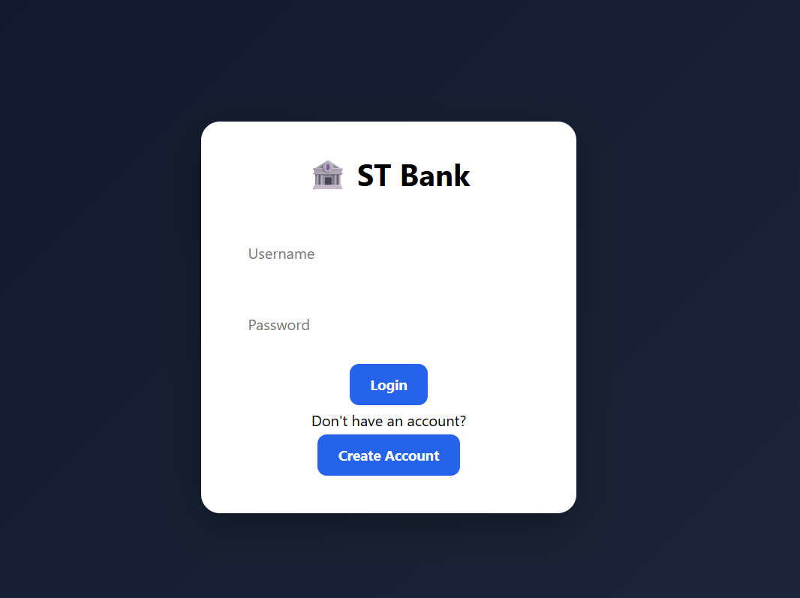
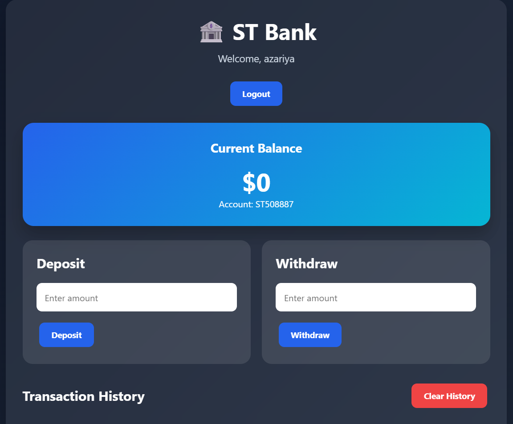

# 🏦 Bank App

A simple, interactive banking application built with HTML, CSS, and JavaScript. Users can create accounts, log in, manage their balance, deposit and withdraw money, and review their transaction history.

## 🌐 Live Demo

[**View Bank App**](https://bank-app-by-azariya.netlify.app/)

## 📸 Screenshots

### Login Page



### Banking Dashboard



## ✨ Features

* **Create an Account:** Register with a username and password.
* **User Login:** Access an account using login credentials.
* **Account Information:** View your username and account number.
* **Balance Tracking:** Monitor your current account balance.
* **Deposit Money:** Add money to your account with amount validation.
* **Withdraw Money:** Withdraw money while preventing withdrawals that exceed the available balance.
* **Transaction History:** View deposits and withdrawals with their transaction times.
* **Clear Transaction History:** Clear your saved transaction history.
* **Local Storage:** Retain account information, balances, and transactions in the browser.
* **Logout:** Log out of the current account.
* **Input Validation:** Handle empty fields, duplicate usernames, invalid amounts, and insufficient balances.

## 🛠️ Technologies Used

* HTML5
* CSS3
* JavaScript (ES6+)
* Browser Local Storage

## 🚀 Getting Started

### Prerequisites

* A modern web browser.
* Visual Studio Code with the Live Server extension (optional).

### Installation

1. Clone the repository:

   ```bash
   git clone https://github.com/Azaariya/Bank-App.git
   ```

2. Navigate to the project folder:

   ```bash
   cd Bank-App
   ```

3. Open `index.html` in your browser, or use the Live Server extension in Visual Studio Code.

No package installation or backend server is required for this version.

## ⚙️ How It Works

1. Create an account with a username and password.
2. Log in to access the banking dashboard.
3. View your account number and balance.
4. Deposit money or withdraw available funds.
5. Review your transaction history or clear it.
6. Log out when you finish.

Account information and transactions are stored in the browser's local storage, so data can persist between page refreshes in the same browser.

## 📚 What I Learned

Building this project helped me practice:

* DOM manipulation and event handling.
* Creating account registration and login flows.
* Working with JavaScript objects and arrays.
* Using `find()` and `findIndex()` to locate user accounts.
* Saving and retrieving data with `localStorage`.
* Validating user input and handling invalid operations.
* Updating balances and recording transactions.
* Formatting transaction times.
* Organizing JavaScript functionality into reusable functions.

## 🔮 Future Improvements

* Add transaction search and filtering.
* Include transaction dates and downloadable account statements.
* Improve form validation and error messages.
* Add money transfers between accounts.
* Improve the interface and mobile responsiveness.
* Add a secure backend and database.
* Implement secure authentication and password hashing.

## ⚠️ Security Note

This is a frontend learning project and is not suitable for real banking or handling real money. Account credentials and financial data are stored in browser local storage, and passwords are not securely hashed. A production banking application would require a secure backend, proper authentication, server-side validation, and protected data storage.

## 👨‍💻 Author

**Azaria**

Fourth-year Electrical and Computer Engineering student at Addis Ababa Science and Technology University.

* **GitHub:** [Azaariya](https://github.com/Azaariya)
* **Repository:** [Bank App](https://github.com/Azaariya/Bank-App)
* **Live Demo:** [Bank App](https://bank-app-by-azariya.netlify.app/)

---

*Built to practice JavaScript, DOM manipulation, and browser storage.*
